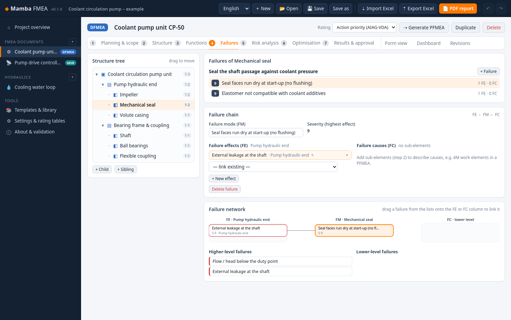
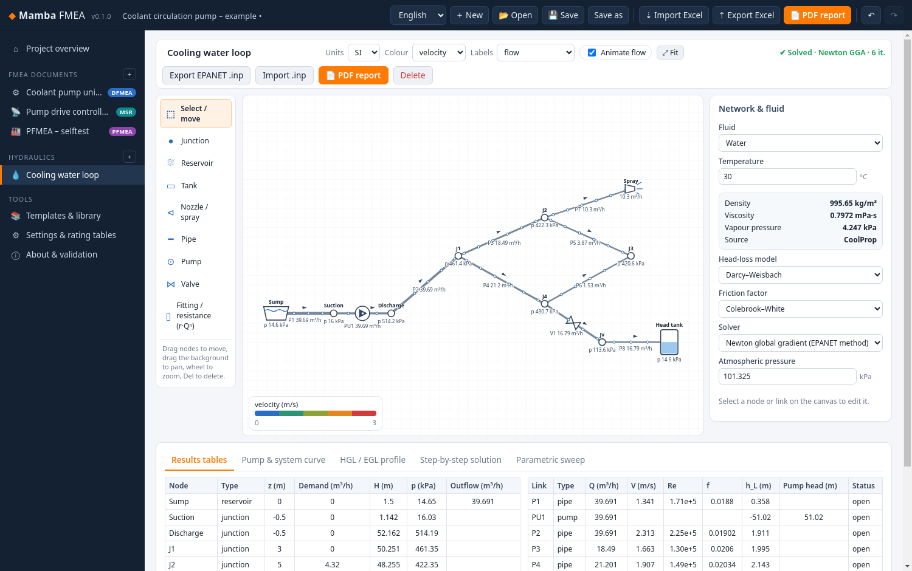
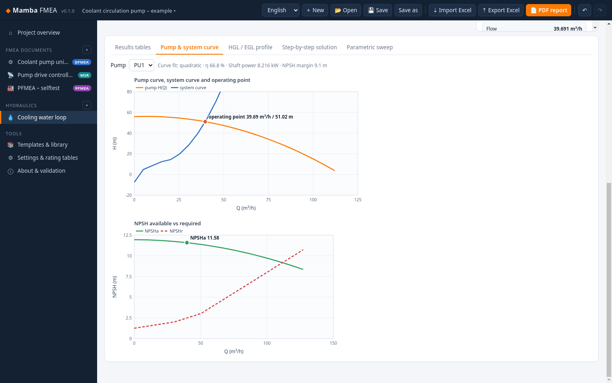
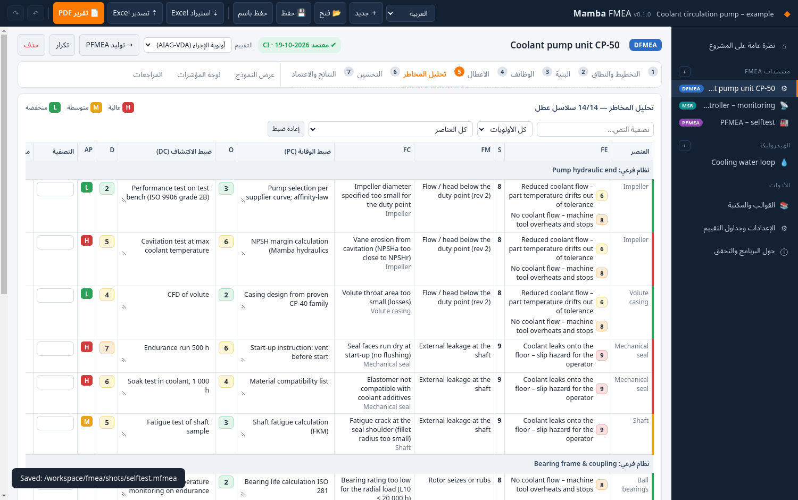

# Mamba FMEA

An offline Windows desktop app for **FMEA** (AIAG‑VDA 7‑step method: DFMEA, PFMEA and FMEA‑MSR) with a **pipe hydraulics** module in the same window. It belongs to the Mamba family of engineering tools. Free for personal use.



## Download

Get the latest build from [Releases](https://github.com/heisenberg0066/mamba-fmea/releases/latest):

| File | Use |
|---|---|
| `MambaFMEA-Setup-x.y.z-x64.exe` | Installer for the current user (no admin rights needed) |
| `MambaFMEA-Portable-x.y.z-x64.exe` | Single exe, nothing installed |
| `MambaFMEA-x.y.z-win-x64.zip` | Unzip and run `Mamba FMEA.exe` |

The builds are **unsigned**. Windows SmartScreen will warn you on first start: click *More info → Run anyway*.

## FMEA

* **The 7 steps:** planning and scope, structure analysis, function analysis, failure analysis, risk analysis, optimisation and results documentation. Each step has its own page.
* **Structure and function/failure trees** with drag‑and‑drop (before, into or after a node), a structure diagram, a function network and a failure‑chain editor (FE ← FM ← FC). Inverse links are shown, so a cause can see its effects.
* **Ratings:** severity, occurrence and detection for DFMEA/PFMEA, and severity, frequency and monitoring for FMEA‑MSR. There is a rating picker with criteria for each value and an **Action Priority** (H/M/L) column. A **classic RPN** mode with configurable thresholds is also available.
* **Form view:** an editable spreadsheet of the classic FMEA form that stays in sync with the trees. It has sorting and per‑column filters.
* **Linking:** generate a PFMEA from a DFMEA, keep linked items in sync, and build a **control plan** from the PFMEA (with manual overrides). There is also a **process flow diagram** with ASME‑style symbols.
* **Library:** templates and a failure‑mode library (design, process and hydraulic components).
* **Revisions:** snapshots with approval data and a field‑level **diff** between any two revisions.
* **Dashboard:** AP distribution, open actions, Pareto of S·O·D or RPN, and before/after optimisation.
* **Reports:** PDF reports (FMEA form, dashboard, control plan) and **Excel export/import** (lossless round trip).
* **Projects:** undo/redo, autosave and `.mfmea` project files.

> **Copyright note.** The app implements the AIAG‑VDA *method* and the *Action Priority logic*. All criteria texts in the rating tables are original wording written for this app. They are not copied from the AIAG‑VDA handbook, and you can override them in *Settings & rating tables*.

## Pipe hydraulics

* **Network canvas:** drag‑and‑drop pipes, junctions, reservoirs, tanks, pumps (curves from points), valves (gate, globe, butterfly, check, PRV, FCV), fittings/minor losses and nozzles/emitters (K·Q^n).
* **Friction:** Darcy–Weisbach with Colebrook–White or Swamee–Jain, or Hazen–Williams. There are material/roughness and standard pipe‑size libraries (ASME B36.10 NPS/schedule, EN 10255, DIN copper, PE/PVC SDR).
* **Fluids:** temperature‑dependent properties for water, sea water, glycol mixes, oils, fuels and gases. Properties come from the **shared engsuite / ThermoStudio core** (`src/vendor/engsuite-core/props.js`, `prop(out, fluid, {T, P})` with `nu` and `Pv`) on top of **CoolProp 6.6 (WASM)**. Built‑in correlations are the fallback. Run `node build/sync-engsuite.mjs ../engsuite` to update the copy.
* **Solvers:** Newton global gradient algorithm (Todini–Pilati, EPANET‑style) and Hardy Cross.
* **Pumps:** pump operating point, system curve, and **NPSHa vs NPSHr** with margin and warning.
* **Display:** animated flow particles, velocity/pressure/head‑loss colour maps, and an HGL/EGL profile along any path.
* **Solution view:** a **step‑by‑step** solution showing Re, f, h_f and minor losses per pipe.
* **Analysis tools:** parametric sweeps (any parameter vs any result), SI/US units, EPANET `.inp` import/export and a PDF report.
* **Hydraulics to FMEA:** send a component's typical failure modes into an FMEA.




## Languages

English, Swedish and Arabic. Arabic uses a full right‑to‑left layout.



## Validation

`npm test` runs the validation suite and writes [docs/VALIDATION.md](docs/VALIDATION.md). That report has 192 checks:

* **Action Priority logic:** spot checks, monotonicity, and the full 1000‑cube H/M/L count. The MSR logic is also checked.
* **FMEA model:** linking, control plan, diff, library and the Excel round trip.
* **Fluids:** built‑in vs CoolProp, the engsuite core vs direct CoolProp, and Çengel table values.
* **Friction factor:** Moody/Prandtl smooth pipe, and Swamee–Jain vs Colebrook.
* **Textbook cases:**
  * Çengel & Cimbala Prob. 8‑48 (Re, f, Δp, h_L, power);
  * a Hardy Cross worked example solved by both solvers;
  * a two‑loop network example.
* **EPANET 2.2 cross‑check:** three networks are exported to `.inp` and solved with the OWA EPANET toolkit. The maximum head difference is ≤ 0.006 m.

The packaged app also has a built‑in UI self‑test (`MAMBA_SELFTEST=<dir>`). CI runs it on `windows-latest` against both the unpacked and the installed app.

## Build from source

```
npm ci
npm test                 # validation suite
npm start                # run the app
npm run dist             # Windows x64 installer, portable exe and zip in dist/
```

## Screenshots

See [docs/screenshots](docs/screenshots).

## License

MIT for the source code (see [LICENSE](LICENSE)). Third‑party components are listed in [THIRD_PARTY_NOTICES.md](THIRD_PARTY_NOTICES.md).
